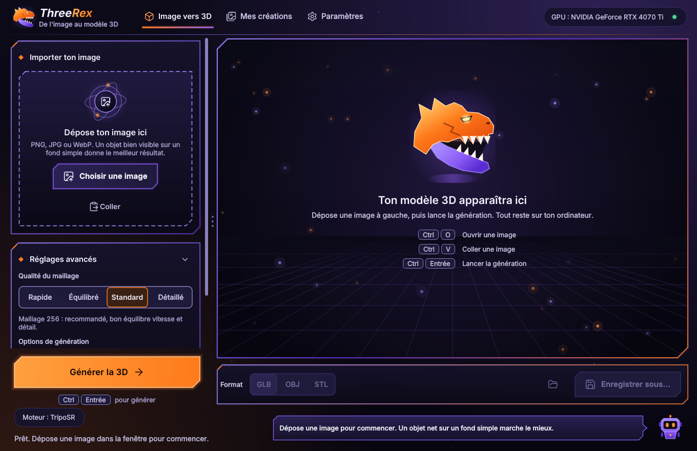
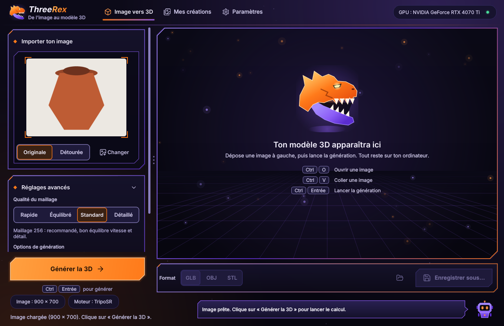
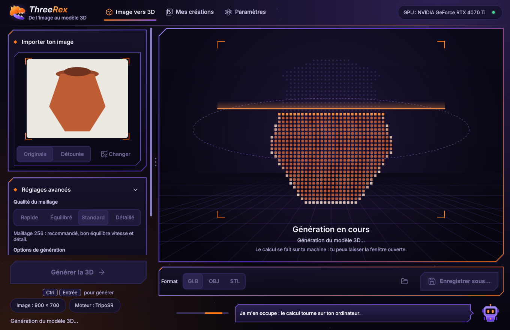
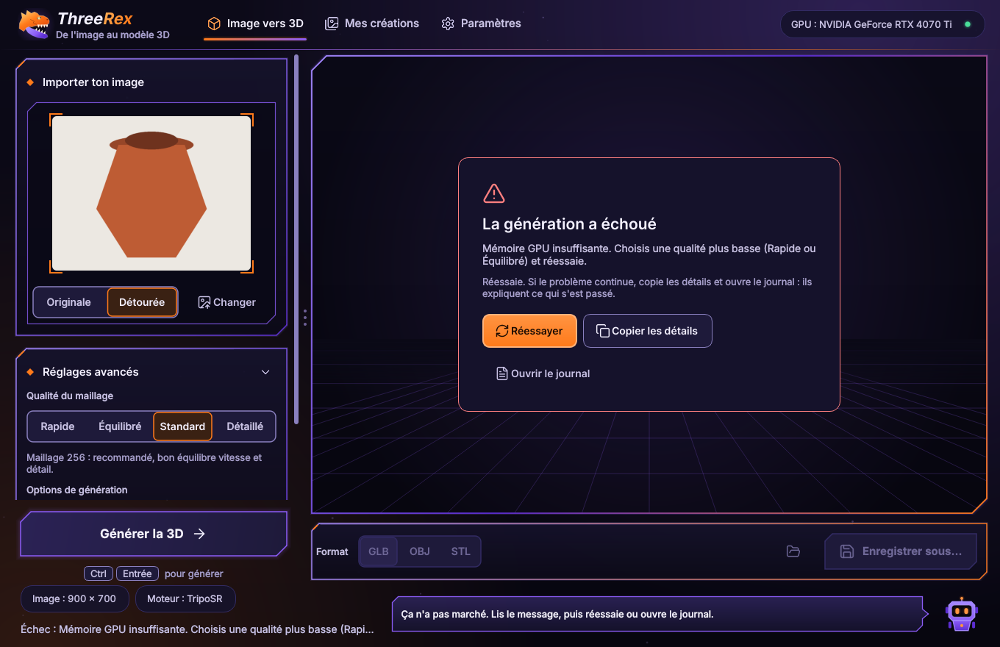
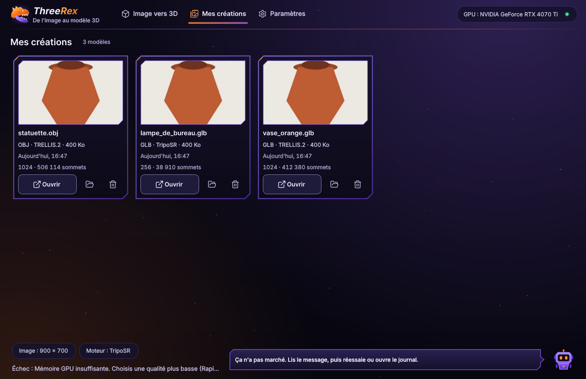
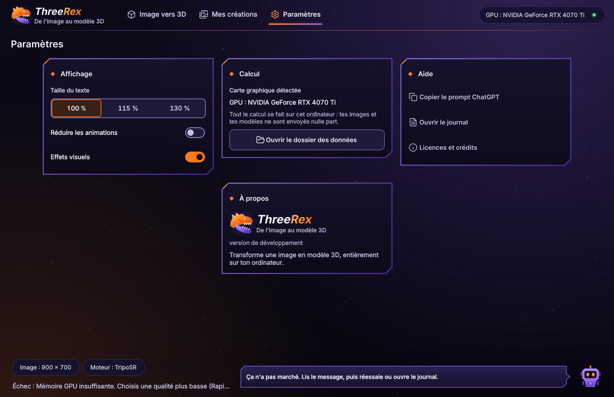

# ThreeRex

Application Windows à usage personnel qui transforme une image en modèle 3D (`.glb`, `.obj` ou `.stl` pour l'impression), **entièrement en local** : ni compte, ni
envoi d'image sur Internet. Pensée pour fabriquer des figurines 3D (sur socle) à partir d'illustrations.

Deux moteurs d'IA, au choix dans la fenêtre :

- **TripoSR** (licence MIT) : rapide (quelques secondes), forme approximative, couleurs par sommet. Fourni avec le logiciel.
- **TRELLIS.2, « Qualité maximale »** (Microsoft, licence MIT, exécuté par [trellis.cpp](https://github.com/pwilkin/trellis.cpp)) :
  le plus détaillé des modèles libres utilisables ici, avec de vraies textures PBR (couleur, métal, rugosité) dans le `.glb`.
  Plus lent (quelques minutes), exige une carte NVIDIA avec un pilote récent (580 ou plus). Il se télécharge au premier usage
  (environ 7,5 Go, une seule fois) : bouton « Installer le moteur » dans la fenêtre. Réglé pour une carte de 12 Go (modèles
  « q4 » ; si la mémoire manque en 1024, le calcul est refait automatiquement en 512).

Retrait du fond : U²-Net via rembg avec TripoSR, BiRefNet avec TRELLIS.2. Aucun moteur libre n'égale à coup sûr un service
payant comme Meshy ; l'écart réel n'a pas été mesuré (voir [docs/QUALITY.md](docs/QUALITY.md)).

> **État : version 0.1.0, pas encore éprouvée sur Windows.**
> Les tests automatiques (moteur d'IA simulé) passent sous Linux. L'installateur est écrit et son test automatique
> (installation silencieuse sur un serveur Windows sans carte graphique) est prévu dans `release.yml`, mais n'a pas encore
> tourné. Le calcul sur carte NVIDIA doit de toute façon être validé sur la machine cible : voir
> [docs/BUILD_AND_RELEASE.md](docs/BUILD_AND_RELEASE.md#validation-sur-un-vrai-ordinateur).
> La nouvelle interface (identité ThreeRex) a été testée en rendu hors écran seulement : états, tailles de fenêtre de 1000 à
> 1920 px, texte à 100 / 115 / 130 %, PySide6 6.9 et 6.12. Le visualiseur OpenGL, la police, la barre de titre sombre et les
> animations en conditions réelles n'ont pas encore été vus sur un écran Windows ([docs/DESIGN.md](docs/DESIGN.md#limites-connues)).

## Aperçu

Interface sombre à l'identité marquée (T-Rex, orange incandescent et violet électrique), pensée pour rester utilisable : une seule
action principale à l'écran, un grand visualiseur 3D, des panneaux redimensionnables, des erreurs expliquées en ligne plutôt
que dans des fenêtres, et des effets (halos, particules, robot assistant) qui s'effacent pendant une manipulation et se coupent
d'un réglage. Captures en rendu hors écran avec un moteur factice : le visualiseur 3D (OpenGL) n'y apparaît pas.
Détails : [docs/DESIGN.md](docs/DESIGN.md).

| Au démarrage | Image chargée | Calcul en cours |
|---|---|---|
|  |  |  |

| Une erreur | Mes créations | Paramètres |
|---|---|---|
|  |  |  |

## Ce que fait le logiciel

- Charge une image (fichier ou presse-papiers), retire le fond, génère un modèle 3D coloré.
- Visionneuse 3D intégrée : pivoter, déplacer, zoomer, réinitialiser, plein écran (F11), boutons pour corriger l'orientation.
- « Mes créations » : retrouve les modèles enregistrés (vignette, moteur, taille, date) ; retirer une carte ne supprime jamais le fichier.
- Export `.glb` (couleurs, normales) ou `.obj` avec vraie texture, maillage allégé et nettoyé (pas de fragments flottants).
- Export `.stl` **pour l'impression 3D** : surface réparée et fermée, mise à l'échelle à la hauteur voulue (en mm), posée à plat, avec
  un rapport franc (étanche ou non, taille, volume). Un STL n'a pas de couleurs : voir `docs/QUALITY.md` pour ce qui n'est pas vérifié.
- Aucun chemin de ton ordinateur n'est écrit dans les fichiers exportés.
- Interface accessible : tout au clavier (focus visible), texte jusqu'à 130 %, animations et effets visuels réductibles.

## Installer (utilisateur)

1. Télécharge `ThreeRex-Setup-<version>.exe` et lance-le (aucun droit administrateur requis).
2. L'installateur copie le logiciel puis télécharge PyTorch et les bibliothèques (plusieurs Go, 10 à 30 minutes).
3. Au premier calcul, les modèles d'IA sont téléchargés une fois (environ 2 Go).

Configuration : Windows 10/11 64 bits, carte NVIDIA récente avec 8 Go de mémoire vidéo ou plus (sans carte NVIDIA, le
logiciel fonctionne mais très lentement), 10 Go d'espace libre, connexion Internet pour l'installation.

Windows SmartScreen affiche « Windows a protégé votre ordinateur » car l'installateur n'est pas signé (c'est ton propre
fichier : « Informations complémentaires » puis « Exécuter quand même »).
Les raccourcis du menu Démarrer incluent **Diagnostic** (vérifie l'installation) et **Réparer l'installation**.

## Documentation

| Document | Contenu |
|---|---|
| [docs/ARCHITECTURE.md](docs/ARCHITECTURE.md) | Organisation du code, de l'installation et des fichiers de l'utilisateur |
| [docs/DESIGN.md](docs/DESIGN.md) | Système de design : couleurs, typographie, composants, accessibilité, comment le modifier |
| [docs/DEVELOPMENT.md](docs/DEVELOPMENT.md) | Installer l'environnement de développement, lancer les tests |
| [docs/BUILD_AND_RELEASE.md](docs/BUILD_AND_RELEASE.md) | Construire l'installateur, publier une version |
| [docs/IMAGE_DE_DEPART.md](docs/IMAGE_DE_DEPART.md) | Obtenir le meilleur résultat : prompt pour créer l'image, ordre des réglages, méthode |
| [docs/QUALITY.md](docs/QUALITY.md) | Qualité des moteurs, ce qui limite sur une carte de 12 Go, pistes d'amélioration |
| [docs/LICENSES.md](docs/LICENSES.md) | Audit des licences et décisions (usage personnel, modèles exclus) |
| [docs/TROUBLESHOOTING.md](docs/TROUBLESHOOTING.md) | Problèmes courants |
| [CHANGELOG.md](CHANGELOG.md) | Historique des versions |
| [THIRD_PARTY_NOTICES.md](THIRD_PARTY_NOTICES.md) | Composants tiers et leurs licences (joint à l'installateur) |

## Organisation du dépôt

```
src/threerex/     le logiciel (interface, génération, export, diagnostic)
design/              jetons de design (couleurs)
tests/               tests automatiques (pytest) et scénarios de bout en bout
packaging/windows/   script Inno Setup, script d'installation des composants, versions épinglées
packaging/build_stage.py   prépare le dossier qui alimente l'installateur
requirements/        dépendances (main.in) et leur version verrouillée pour Windows
scripts/             outils du dépôt (rapport de licences, captures d'écran, icône)
.github/workflows/   ci.yml (tests à chaque modification), release.yml (installateur publié sur une release)
```

## Licence

Code propriétaire, tous droits réservés ([LICENSE](LICENSE), texte provisoire à faire relire). Les composants tiers gardent
leurs licences : [THIRD_PARTY_NOTICES.md](THIRD_PARTY_NOTICES.md).
