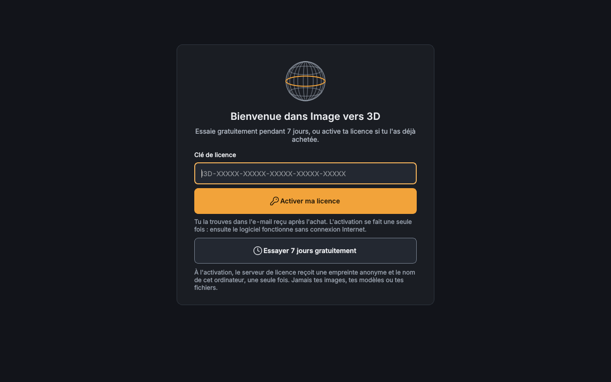
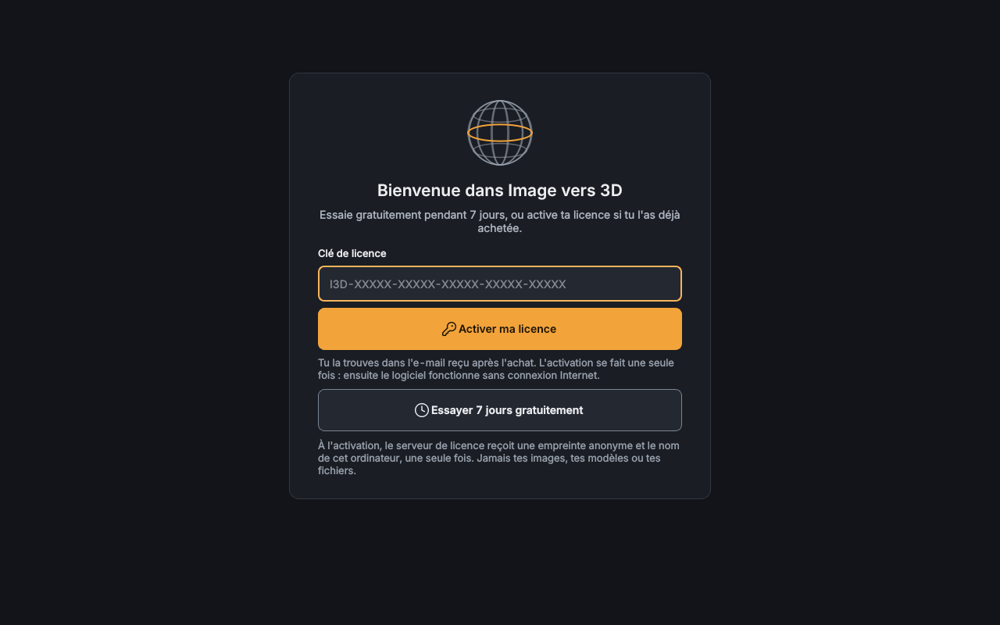
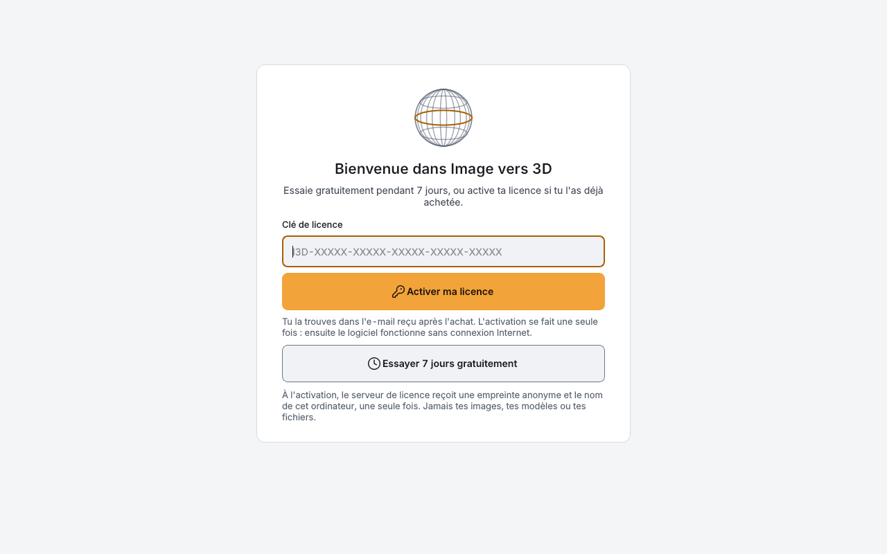
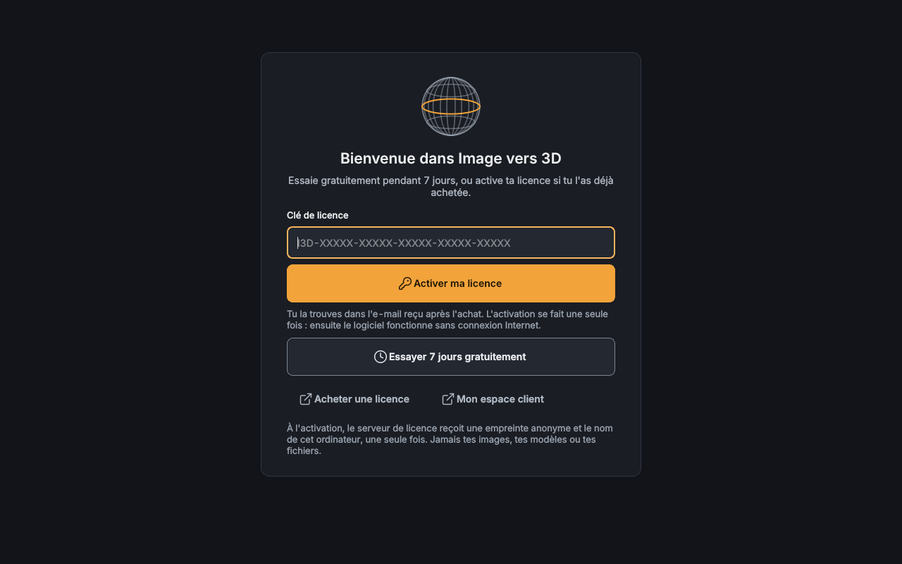
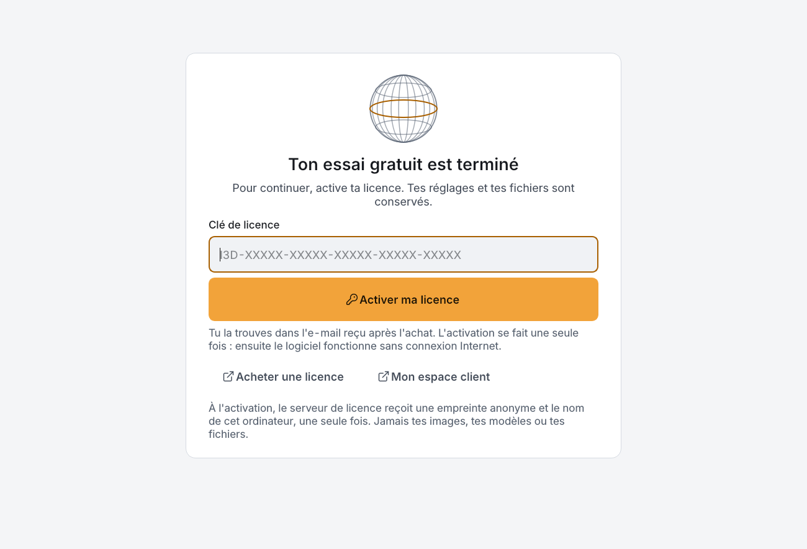
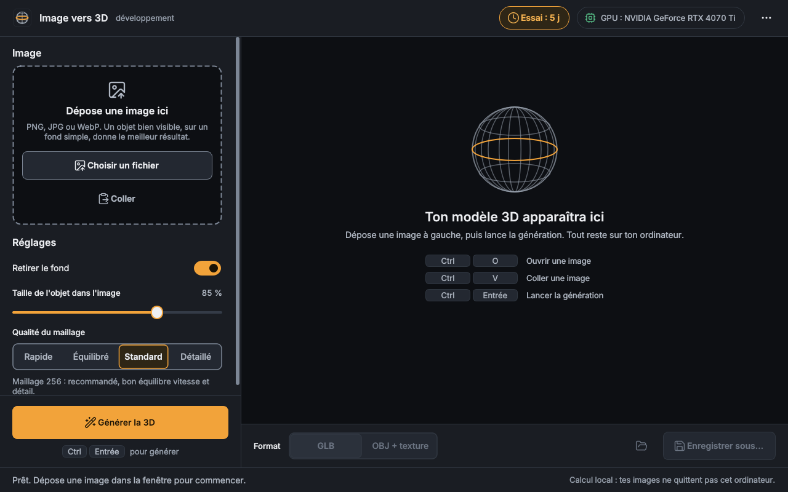

# Image vers 3D

Application Windows qui transforme une image en modèle 3D (`.glb` ou `.obj`), **entièrement en local** : aucune image
n'est envoyée sur Internet. Logiciel payant : essai de 7 jours, puis licence à achat unique (2 ordinateurs), activée **une
seule fois** en ligne, ensuite utilisable hors ligne ([docs/LICENSING.md](docs/LICENSING.md)). Pensée pour fabriquer des
figurines 3D (sur socle) à partir d'illustrations.

Moteur d'IA : [TripoSR](https://github.com/VAST-AI-Research/TripoSR) (licence MIT). Retrait du fond : U²-Net via rembg.

> **État : version 0.1.0, pas encore éprouvée sur Windows.**
> Les tests automatiques (moteur d'IA simulé) passent sous Linux. L'installateur est écrit et son test automatique
> (installation silencieuse sur un serveur Windows sans carte graphique) est prévu dans `release.yml`, mais n'a pas encore
> tourné. Le calcul sur carte NVIDIA doit de toute façon être validé sur la machine cible : voir
> [docs/BUILD_AND_RELEASE.md](docs/BUILD_AND_RELEASE.md#validation-sur-un-vrai-ordinateur).
> Le système de licence (protocole, serveur, compilation des modules de licence) est testé sous Linux ; il n'a jamais tourné
> sur Windows, ni avec un vrai Stripe, un vrai serveur d'e-mails ou un vrai hébergement
> ([docs/LICENSING.md](docs/LICENSING.md#ce-qui-na-pas-été-vérifié)). Il freine la copie et le partage ; il ne rend pas le logiciel
> incassable (aucun logiciel Python ne l'est).
> La nouvelle interface a été testée en rendu hors écran (états, thèmes, texte à 130 %), mais pas encore vue sur un vrai
> écran Windows : visualiseur OpenGL, rendu de la police et menu Réglages restent à confirmer
> ([docs/DESIGN.md](docs/DESIGN.md#limites-connues)).

## Aperçu

Interface sombre par défaut (thème clair et « Système » au choix), une seule action principale à l'écran, erreurs
expliquées en ligne plutôt que dans des fenêtres. Captures en rendu hors écran avec un moteur factice : le visualiseur 3D
(OpenGL) n'y apparaît pas. Détails : [docs/DESIGN.md](docs/DESIGN.md).

| Au démarrage | Une erreur | Thème clair |
|---|---|---|
|  |  |  |

| Premier lancement | Essai terminé (texte 130 %) | Essai en cours |
|---|---|---|
|  |  |  |

## Ce que fait le logiciel

- Charge une image (fichier ou presse-papiers), retire le fond, génère un modèle 3D coloré.
- Visionneuse 3D intégrée, avec les boutons pour corriger l'orientation du modèle.
- Export `.glb` (couleurs, normales) ou `.obj` avec vraie texture, maillage allégé et nettoyé (pas de fragments flottants).
- Aucun chemin de ton ordinateur n'est écrit dans les fichiers exportés.
- Interface accessible : tout au clavier (focus visible), texte jusqu'à 130 %, thème sombre, clair ou celui de Windows,
  animations réductibles.

## Installer (utilisateur)

1. Télécharge `ImageVers3D-Setup-<version>.exe` et lance-le (aucun droit administrateur requis).
2. L'installateur copie le logiciel puis télécharge PyTorch et les bibliothèques (plusieurs Go, 10 à 30 minutes).
3. Au premier lancement, démarre l'essai de 7 jours ou colle la clé de licence reçue par e-mail (connexion Internet requise
   **cette fois-là seulement**).
4. Au premier calcul, les modèles d'IA sont téléchargés une fois (environ 2 Go).

Configuration : Windows 10/11 64 bits, carte NVIDIA récente avec 8 Go de mémoire vidéo ou plus (sans carte NVIDIA, le
logiciel fonctionne mais très lentement), 10 Go d'espace libre, connexion Internet pour l'installation.

Windows SmartScreen peut afficher « Windows a protégé votre ordinateur » tant que l'installateur n'est pas signé :
[docs/DISTRIBUTION.md](docs/DISTRIBUTION.md#signature-et-smartscreen).
Les raccourcis du menu Démarrer incluent **Diagnostic** (vérifie l'installation) et **Réparer l'installation**.

## Documentation

| Document | Contenu |
|---|---|
| [docs/ARCHITECTURE.md](docs/ARCHITECTURE.md) | Organisation du code, de l'installation et des fichiers de l'utilisateur |
| [docs/DESIGN.md](docs/DESIGN.md) | Système de design : couleurs, typographie, composants, accessibilité, comment le modifier |
| [docs/DEVELOPMENT.md](docs/DEVELOPMENT.md) | Installer l'environnement de développement, lancer les tests |
| [docs/BUILD_AND_RELEASE.md](docs/BUILD_AND_RELEASE.md) | Construire l'installateur, publier une version |
| [docs/LICENSING.md](docs/LICENSING.md) | Licences et comptes : fonctionnement, **limites de la protection**, construire une version commerciale |
| [docs/SERVER.md](docs/SERVER.md) | Serveur de licences : installation, Stripe, sauvegardes, support |
| [docs/DISTRIBUTION.md](docs/DISTRIBUTION.md) | Vendre et livrer le logiciel, signature du code |
| [docs/LICENSES.md](docs/LICENSES.md) | Audit des licences et décisions (à lire avant de vendre) |
| [docs/TROUBLESHOOTING.md](docs/TROUBLESHOOTING.md) | Problèmes courants |
| [CHANGELOG.md](CHANGELOG.md) | Historique des versions |
| [THIRD_PARTY_NOTICES.md](THIRD_PARTY_NOTICES.md) | Composants tiers et leurs licences (joint à l'installateur) |

## Organisation du dépôt

```
src/imagevers3d/     le logiciel (interface, génération, export, diagnostic)
design/              jetons de design (couleurs des thèmes), partagés avec la maquette Figma
tests/               tests automatiques (pytest) et scénarios de bout en bout
packaging/windows/   script Inno Setup, script d'installation des composants, versions épinglées, contrat d'utilisation
packaging/build_stage.py   prépare le dossier qui alimente l'installateur (refuse une wheel dont la licence n'est pas compilée)
packaging/verify_wheel.py  contrôle une wheel commerciale
setup.py             compilation des modules de licence (version commerciale)
server/              serveur de licences (FastAPI + SQLite), Docker, Caddy, tests
tools/               licence de développement (tests, captures, CI)
requirements/        dépendances (main.in) et leur version verrouillée pour Windows
scripts/             outils du dépôt (rapport de licences)
.github/workflows/   ci.yml (tests à chaque modification), release.yml (installateur publié sur une release)
```

## Licence

Code propriétaire, tous droits réservés ([LICENSE](LICENSE), texte provisoire à faire relire). Les composants tiers gardent
leurs licences : [THIRD_PARTY_NOTICES.md](THIRD_PARTY_NOTICES.md).
